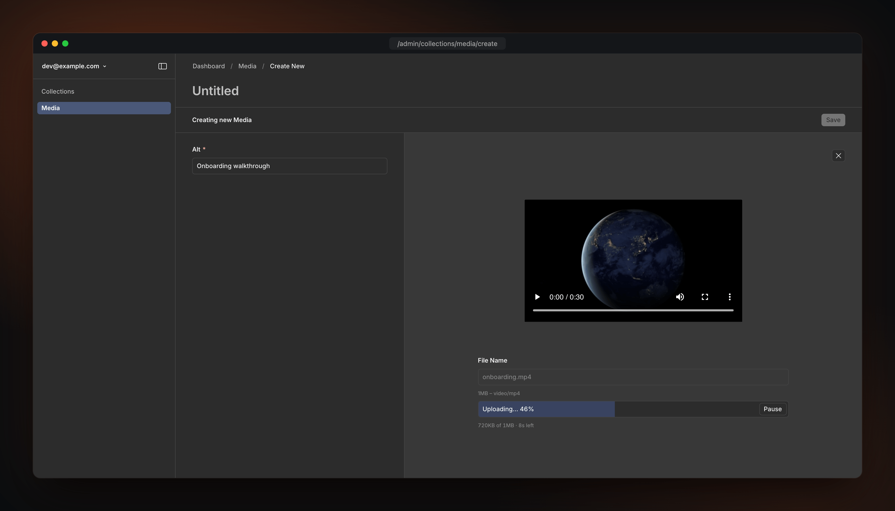
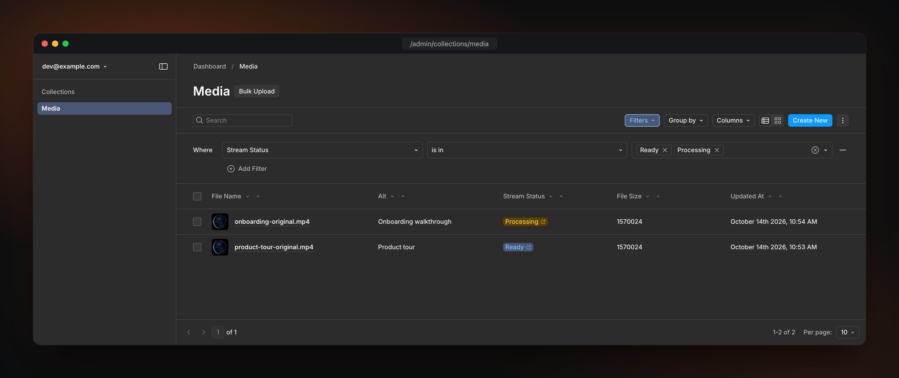
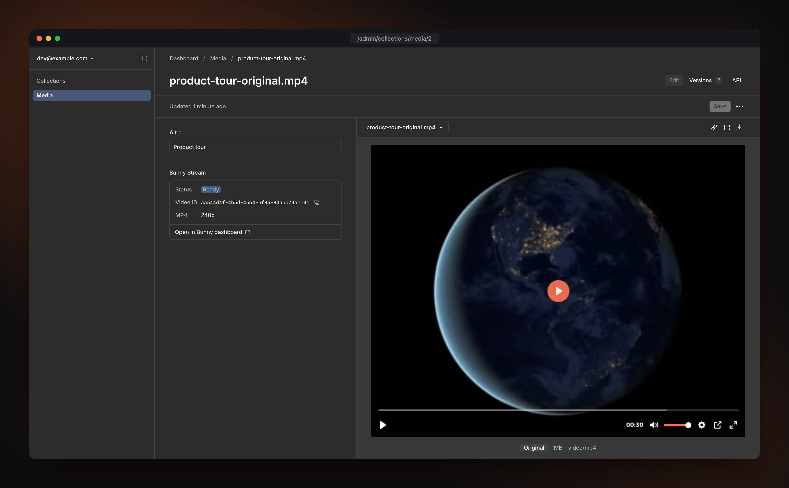
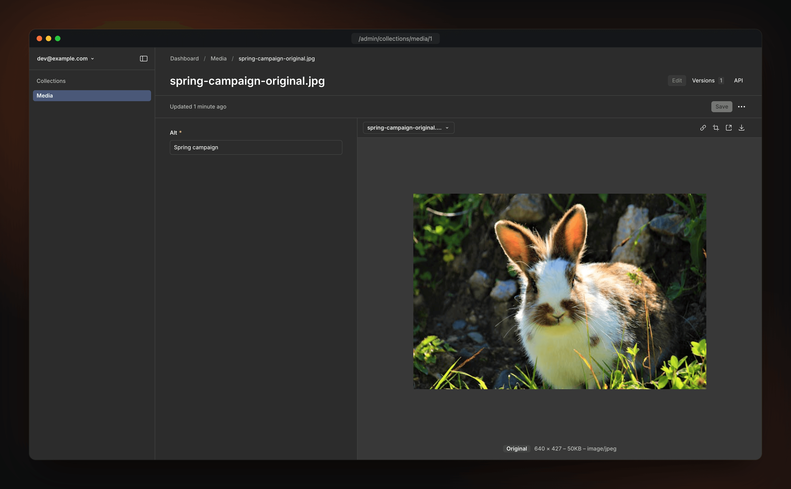

<div align="center">

<picture>
  
</picture>

<h1>Bunny.net Storage for Payload</h1>

<a href="https://bunny.net?ref=fndfoymy0j"></a>

<p>Store files and stream video from Payload on Bunny's fast global CDN.</p>

<a href="https://github.com/maximseshuk/payload-storage-bunny/releases/"></a>
<a href="https://www.npmjs.com/package/@seshuk/payload-storage-bunny"></a>
<a href="https://www.npmjs.com/package/@seshuk/payload-storage-bunny"></a>
<a href="https://github.com/maximseshuk/payload-storage-bunny/actions/workflows/ci.yml"></a>
<a href="https://payload-storage-bunny.seshuk.im/"></a>
<a href="https://github.com/maximseshuk/payload-storage-bunny/blob/main/LICENSE"></a>
<a href="https://ko-fi.com/seshuk"></a>

</div>

## Features

- **Bunny Storage** — upload files, images, and documents to Bunny's global CDN.
- **Bunny Stream** — video with HLS/MP4 streaming, adaptive bitrates, thumbnails, a built-in player, and TUS resumable uploads for large files.
- **Stream status** — see in the admin whether each video is still encoding, ready, or failed.
- **File versions** — with Payload `versions` (on by default in Payload 4), a replaced file or video stays in Bunny while a version uses it, so restoring a version brings back a working file. Set `versions: false` on a collection to delete the old file on replace.
- **Client-direct uploads** — file bytes go straight from the browser to Bunny (presigned S3 or a Bunny Edge Script), bypassing serverless body-size limits.
- **Signed URLs** — time-limited links with country restrictions and per-client IPv4 locking, for both Storage and Stream.
- **CDN cache purging** — auto-invalidate the CDN when a file is deleted. Every upload gets a new URL, so visitors never see an old copy of a replaced file.
- **Thumbnails** — admin-panel and API previews, with on-the-fly resizing via Bunny Optimizer.
- **Per-collection overrides** — tune any setting per collection, or point a collection at its own zone / library for multi-tenant setups.
- **Setup wizard & CLI** — one command provisions your Bunny resources and prints ready-to-paste options; a second deploys the client-uploads Edge Script.

## Screenshots

A resumable TUS upload straight from the browser to Bunny Stream:



The Stream status in the list view, with a filter:



The Bunny Stream player and the status card in the edit view:



An image served from Bunny Storage:



## Quick start

Requires **Payload 4.0.0-beta.4 or later** (canary builds are not supported), **Next.js >=16.4 <17**, **React 19** and **Node.js 24.22.1 or later**. For Payload 3, use `@seshuk/payload-storage-bunny@3`.

> [!IMPORTANT]
> **Upgrading from v3?** Register the adapter under `storage` instead of `plugins`. Some options are renamed, and the plugin throws at startup with the new name for each old key. Custom upload clients must move to Payload's `POST /api/upload-instructions` endpoint, and SQL databases need a migration for the new upload fields (`prefix`, the `original` group, and `prefix` and `_objectKey` on image variants). Every database, MongoDB too, first needs Payload's `sizes-to-variants` migration. Follow the [Upgrade Guide](https://payload-storage-bunny.seshuk.im/v4/upgrade-guide).
>
> **Upgrading from v2?** Upgrade to v3 on Payload 3 first and run its one-time data migration. The migration helper ships only in v3 and is removed in v4. Back up your database, then follow the same [Upgrade Guide](https://payload-storage-bunny.seshuk.im/v4/upgrade-guide).

### Setup wizard (recommended)

One interactive command provisions the Bunny resources you need — storage zone, pull zone, and/or video library — with production defaults, then prints a ready-to-paste `bunnyStorage({ … })` block and the matching `.env` lines. Nothing billable is created without confirmation.

```bash
npx @seshuk/payload-storage-bunny@beta init
```

See the [Setup Wizard](https://payload-storage-bunny.seshuk.im/v4/cli/init) docs. Prefer to wire it up by hand? Follow the [Quick Start](https://payload-storage-bunny.seshuk.im/v4/quick-start).

### Install

```bash
npm install @seshuk/payload-storage-bunny@beta @payloadcms/plugin-cloud-storage@4.0.0-beta.4 @payloadcms/translations@4.0.0-beta.4 @payloadcms/ui@4.0.0-beta.4 sanitize-filename@1.6.4
```

v4 is in beta under the `beta` npm tag, and Payload 4 is published under `beta`. The command also installs the peer dependencies that a Payload app does not have yet. `payload` and React 19 are already in your app. Use the same exact version for `@payloadcms/plugin-cloud-storage`, `@payloadcms/translations`, `@payloadcms/ui` and your `payload` package. For Payload 3, use `@seshuk/payload-storage-bunny@3`.

### Configure

Add the adapter to the `storage` array of your Payload config, pointing it at an upload collection:

```typescript
import { bunnyStorage } from '@seshuk/payload-storage-bunny'
import { buildConfig } from 'payload'

export default buildConfig({
  storage: [
    bunnyStorage({
      collections: {
        media: {
          prefix: 'media',
          disablePayloadAccessControl: true, // serve directly from Bunny's CDN
        },
      },
      storage: {
        apiKey: process.env.BUNNY_STORAGE_API_KEY!,
        hostname: process.env.BUNNY_STORAGE_HOSTNAME!, // your Pull Zone host, e.g. example.b-cdn.net
        zoneName: process.env.BUNNY_STORAGE_ZONE_NAME!,
      },
    }),
  ],
})
```

Add `stream` for video, `purge` for cache invalidation, `signedUrls` for secure links, and more — see the [configuration reference](https://payload-storage-bunny.seshuk.im/v4/configuration/overview).

## Documentation

Full docs are at **<https://payload-storage-bunny.seshuk.im/>**:

- [Quick Start](https://payload-storage-bunny.seshuk.im/v4/quick-start)
- [Configuration reference](https://payload-storage-bunny.seshuk.im/v4/configuration/overview)
- [Collection overrides & multi-tenant](https://payload-storage-bunny.seshuk.im/v4/configuration/collection-overrides)
- [Client uploads](https://payload-storage-bunny.seshuk.im/v4/configuration/storage/client-uploads)
- [Signed URLs](https://payload-storage-bunny.seshuk.im/v4/configuration/signed-urls)
- [CLI — setup wizard & Edge Script deploy](https://payload-storage-bunny.seshuk.im/v4/cli/init)
- [Upgrade Guide](https://payload-storage-bunny.seshuk.im/v4/upgrade-guide)
- [Examples](https://payload-storage-bunny.seshuk.im/v4/guides/examples)

## Telemetry

The plugin sends an anonymous, opt-out usage report once per day: plugin, Payload, and Node versions plus which features are enabled. It never sends secrets, IPs, keys, zone/library names, hostnames, countries, file paths, or collection names. A one-time notice prints on first run.

Opt out with `telemetry: false`, `DO_NOT_TRACK=1`, or `BUNNY_TELEMETRY_DISABLED=1` (also disabled automatically in CI and when `payload.config.telemetry` is `false`). See [Telemetry](https://payload-storage-bunny.seshuk.im/v4/configuration/telemetry) for the full list of what is and isn't collected.

## Related plugins

- **[@seshuk/payload-plugin-media-preview](https://github.com/maximseshuk/payload-plugin-media-preview)** — preview images, video, audio and documents in the Payload admin panel. Works with any storage adapter; ships a [Bunny Stream adapter](https://payload-storage-bunny.seshuk.im/v4/guides/media-preview) for this plugin.
- **[@seshuk/payload-plugin-janitor](https://github.com/maximseshuk/payload-plugin-janitor)** — find orphaned files and unused documents, then delete only what you approve.
- **[@seshuk/payload-plugin-sitemap](https://github.com/maximseshuk/payload-plugin-sitemap)** — sitemaps for Payload, stored with any storage adapter.
- **[@seshuk/payload-plugin-openapi](https://github.com/maximseshuk/payload-plugin-openapi)** — OpenAPI 3.0, 3.1 and 3.2 spec for Payload, with Scalar or Swagger UI.

## Support

Bug reports, feature requests, and questions go to [GitHub Issues](https://github.com/maximseshuk/payload-storage-bunny/issues). For Payload itself, see the [Payload docs](https://payloadcms.com/docs) and [Discord](https://discord.gg/payloadcms).

## License

MIT — see [LICENSE](LICENSE).

## Credits

Built by [Maxim Seshuk](https://github.com/maximseshuk) for the Payload community.

If this plugin saves you time, you can [buy me a coffee](https://ko-fi.com/seshuk) ☕

---

**Disclosure**: links to bunny.net in this README are referral links.
